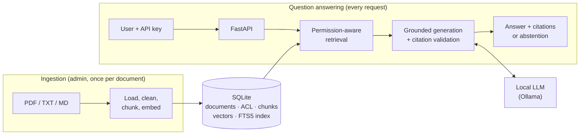
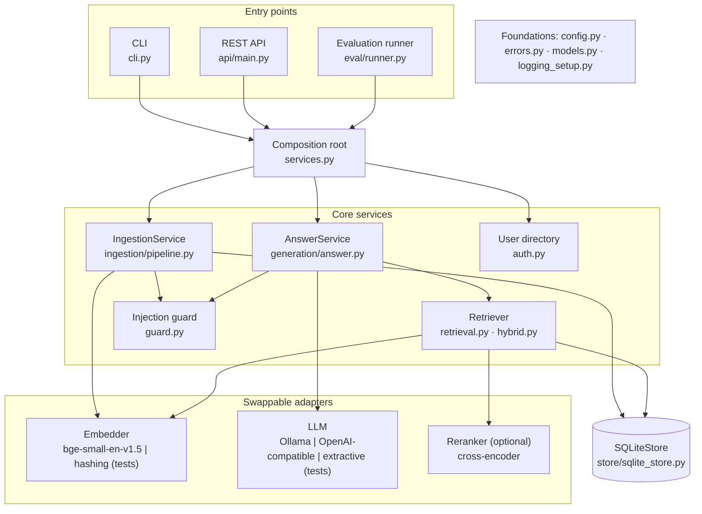
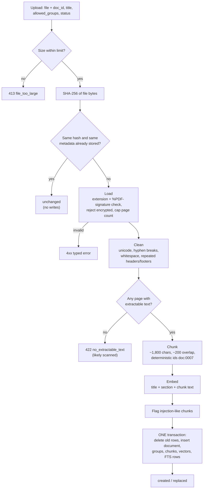
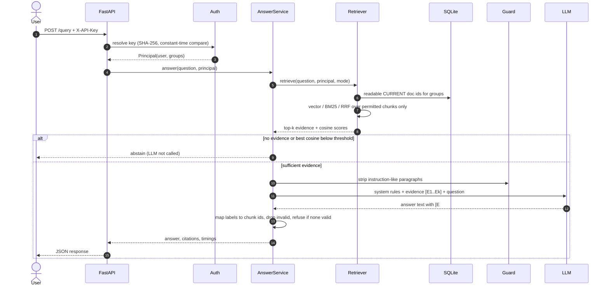
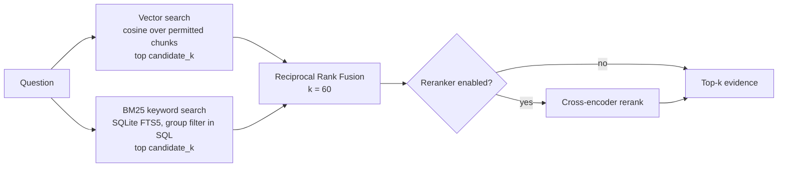
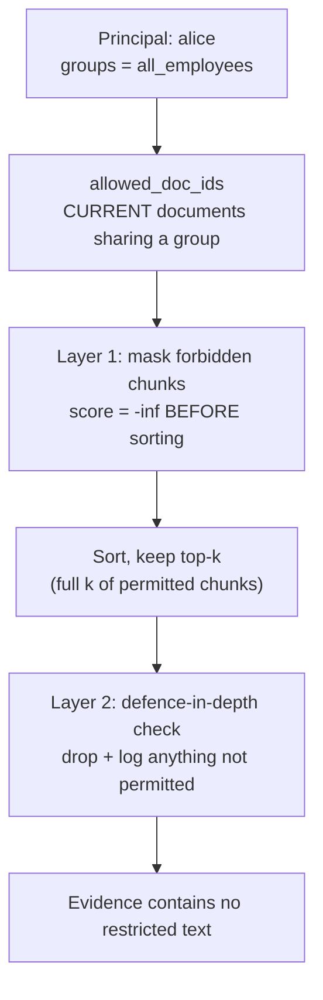
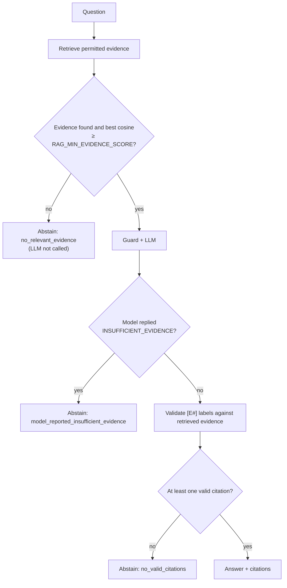
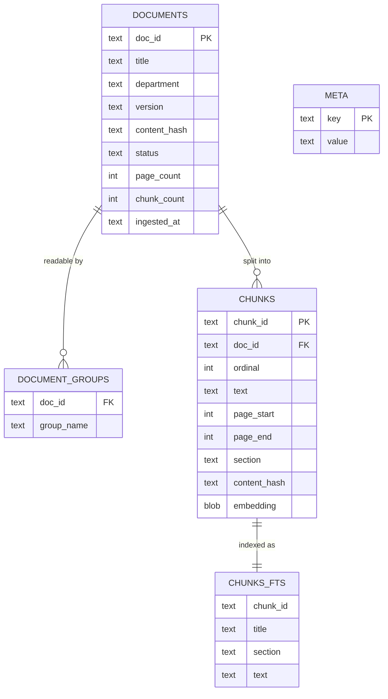
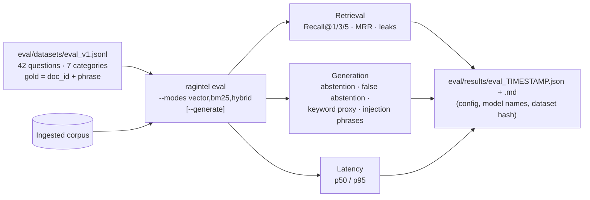

# enterprise-rag-intelligence

An enterprise document intelligence system using hybrid search, RAG, and LLM evaluation to deliver accurate, source-grounded answers from internal knowledge bases.

> **Status: under active development, prototype.**
> Identity is simulated with API keys and the system has not been validated for production use.
> Do not load real confidential or personal data. See [Project status](#project-status) and [Limitations](#limitations).

---

## Table of contents

- [What it does](#what-it-does)
- [Why this project exists](#why-this-project-exists)
- [Architecture](#architecture)
  - [System overview](#1-system-overview)
  - [Component architecture](#2-component-architecture)
  - [Document ingestion flow](#3-document-ingestion-flow)
  - [Question answering flow](#4-question-answering-flow)
  - [Hybrid retrieval](#5-hybrid-retrieval)
  - [Permission-aware retrieval](#6-permission-aware-retrieval)
  - [Abstention logic](#7-abstention-logic)
  - [Data model](#8-data-model)
  - [Evaluation workflow](#9-evaluation-workflow)
- [Tech stack](#tech-stack)
- [Repository structure](#repository-structure)
- [Getting started (Windows)](#getting-started-windows)
- [Usage](#usage)
- [API reference](#api-reference)
- [Evaluation](#evaluation)
- [Testing](#testing)
- [Security design](#security-design)
- [Key design decisions](#key-design-decisions)
- [Project status](#project-status)
- [Limitations](#limitations)
- [Roadmap](#roadmap)
- [License](#license)

---

## What it does

Employees ask natural-language questions about internal policies. The system:

1. **Retrieves** the most relevant passages from company documents, using vector, keyword (BM25) or hybrid search.
2. **Filters by permission** *before* ranking, so a user only ever receives content their groups may read.
3. **Generates** a short answer from that evidence only, using a local LLM.
4. **Cites** the exact document, page and chunk for every claim, and **validates every citation in code**.
5. **Abstains** ("I could not find enough evidence...") instead of guessing when evidence is weak or missing.

**Example**

```text
Q (alice):     How many unused leave days can I carry over?
A:             Employees may carry over a maximum of 8 unused days into the next calendar year;
               carried-over days must be used by 31 March. [E1]
Citation:      [E1] Annual Leave Policy (HR-POL-014), p.1  (hr-leave-policy:0001)

Q (alice):     What is the salary range for grade G4?
A:             I could not find enough evidence in the documents available to you to answer this question.
               (alice is not in the hr_restricted group, so the salary document is never retrieved)
```

## Why this project exists

Most RAG demos answer questions. This project focuses on what makes a RAG system **trustworthy**:

| Problem with typical RAG demos | How this project addresses it |
|---|---|
| Answers sound confident but are invented | Three abstention checkpoints; uncited answers are refused |
| Citations are generated by the model and can be fake | Citation labels are mapped to real chunk ids **in code**; invalid ones are dropped |
| Every user can retrieve every document | Group-based access control applied **inside retrieval**, before ranking, plus a zero-tolerance leak test suite |
| "Hybrid search is better" is assumed | A versioned evaluation set measures vector vs BM25 vs hybrid; the default is chosen from evidence |
| Outdated policy versions get quoted | Documents carry a `status`; superseded versions are never retrieved |
| Instructions hidden in documents hijack the model | Evidence is treated as untrusted; a guard strips instruction-like text and flags it at ingestion |

The corpus is a fictional company, **Northwind Logistics** (HR, IT, finance and operations policies), with deliberately planted hard cases: a restricted salary document, operations-only procedures, a superseded expense policy, exact policy codes, and a document containing a prompt injection.

---

## Architecture

### 1. System overview

Two independent flows share one database: **ingestion** prepares documents ahead of time, and **question answering** runs on every request.



### 2. Component architecture

All components are wired in one composition root (`services.py`), so the API, the CLI, the evaluation runner and the tests exercise exactly the same code.



### 3. Document ingestion flow

Uploads are untrusted. Every write for a document happens in **one database transaction**, so a crash mid-ingest leaves the previous version intact.



### 4. Question answering flow



### 5. Hybrid retrieval

Embeddings capture meaning ("holiday" ≈ "annual leave"); BM25 captures exact tokens ("HR-POL-015"). Reciprocal Rank Fusion merges the two ranked lists using ranks only, so the scores never need normalising: `score(d) = Σ 1 / (60 + rank(d))`.



### 6. Permission-aware retrieval

Access control is enforced **inside retrieval, before ranking**. There is no retrieval method that runs without a `Principal`.



| Document | `allowed_groups` | alice | harry_hr | olivia_ops |
|---|---|:-:|:-:|:-:|
| Annual Leave Policy | `all_employees` | ✅ | ✅ | ✅ |
| Salary Bands 2026 | `hr_restricted` | ❌ | ✅ | ❌ |
| Warehouse Safety SOP | `operations` | ❌ | ❌ | ✅ |
| Expense Policy v1 (superseded) | `all_employees` | never retrieved | never retrieved | never retrieved |

The abstention message is identical for "not in the documents" and "not permitted", so responses never reveal that a restricted document exists.

### 7. Abstention logic



### 8. Data model

One SQLite file is the single system of record, so the keyword index and the vectors can never drift apart.



- `status` is `current` or `superseded`. `embedding` holds float32 vectors (384 dimensions for bge-small).
- `META` records the embedding model and dimension; startup refuses to mix vectors from different models.
- Deleting a document cascades to its groups and chunks; FTS rows are removed in the same transaction.

### 9. Evaluation workflow



---

## Tech stack

| Layer | Choice | Why |
|---|---|---|
| Language | Python 3.11 / 3.12 | Prebuilt Windows wheels for every dependency |
| API | FastAPI + Pydantic v2 | Typed validation, automatic OpenAPI docs |
| Configuration | pydantic-settings | Typed settings from env vars and `.env`, validated at startup |
| PDF parsing | pypdf | Pure Python, BSD licence, safe failure on malformed files |
| Embeddings | `BAAI/bge-small-en-v1.5` via sentence-transformers | Strong retrieval quality for its size, runs on CPU |
| Storage | SQLite (WAL) | One file, one transaction per document, zero extra services |
| Keyword search | SQLite FTS5 (`bm25()`, porter stemming) | Built in, filtered in the same SQL query as the ACL |
| Vector search | NumPy brute-force cosine | Milliseconds at ~10k chunks; no second store to keep consistent |
| LLM | Ollama (`llama3.2:3b` default) | Free, local, private; swappable via one setting |
| Testing | pytest, FastAPI TestClient | Offline, deterministic, runs in CI on Windows and Ubuntu |

No RAG framework (LangChain / LlamaIndex) is used. A small custom pipeline keeps every prompt, score and filter visible and testable ([ADR-0002](docs/adr/0002-custom-pipeline-no-framework.md)).

## Repository structure

```text
enterprise-rag-intelligence/
├── src/ragintel/
│   ├── config.py              # typed settings (env vars > .env > defaults)
│   ├── errors.py              # typed errors with safe messages + HTTP status
│   ├── models.py              # Chunk, DocumentRecord, Principal, AnswerResult
│   ├── logging_setup.py       # logs ids/scores/timings, never document text
│   ├── ingestion/
│   │   ├── loaders.py         # safe PDF/TXT/MD loading
│   │   ├── cleaning.py        # text normalisation, header/footer removal
│   │   ├── chunking.py        # structure-aware chunking, deterministic ids
│   │   └── pipeline.py        # idempotent, atomic ingestion
│   ├── embeddings.py          # bge-small embedder + offline hashing embedder
│   ├── store/sqlite_store.py  # documents, ACL, chunks, vectors, FTS5
│   ├── guard.py               # heuristic prompt-injection detector
│   ├── retrieval.py           # permission-aware vector retrieval
│   ├── hybrid.py              # safe FTS5 queries + reciprocal rank fusion
│   ├── rerank.py              # optional cross-encoder reranker
│   ├── generation/
│   │   ├── prompts.py         # grounded system prompt, evidence tagging
│   │   ├── llm.py             # Ollama / OpenAI-compatible / extractive adapters
│   │   └── answer.py          # evidence gate, citation validation, abstention
│   ├── auth.py                # simulated users with hashed API keys
│   ├── services.py            # composition root
│   ├── cli.py                 # `ragintel` command
│   ├── eval/                  # metrics + evaluation runner
│   └── api/                   # FastAPI app, schemas, auth dependencies
├── tests/                     # one test file per milestone
├── data/sample_docs/          # fictional Northwind corpus (committed)
├── data/public_docs/          # NIST PDF manifest (PDFs downloaded, not committed)
├── eval/datasets/             # versioned evaluation questions
├── eval/results/              # committed evaluation reports
├── docs/                      # architecture + ADRs
├── .github/workflows/         # CI: tests on Windows and Ubuntu
├── pyproject.toml
├── constraints.txt            # exact tested dependency versions
└── .env.example               # every setting documented, no secrets
```

## Getting started (Windows)

**Prerequisites:** Python 3.11 or 3.12, Git, and [Ollama](https://ollama.com) for real answers.

```powershell
git clone https://github.com/mrinal97-tech/enterprise-rag-intelligence.git
cd enterprise-rag-intelligence

py -3.12 -m venv .venv
.\.venv\Scripts\Activate.ps1          # Command Prompt: .venv\Scripts\activate

python -m pip install --upgrade pip
pip install -e ".[dev,ml]" -c constraints.txt   # ml = sentence-transformers + PyTorch (CPU)

Copy-Item .env.example .env           # Command Prompt: copy .env.example .env
```

Create users and ingest the sample corpus:

```powershell
ragintel create-users                 # prints API keys ONCE; config/users.json is git-ignored
ragintel ingest-manifest data/sample_docs/manifest.json
ollama pull llama3.2:3b
```

**Offline mode** (no model downloads, no Ollama), for tests and CI only:

```powershell
$env:RAG_EMBEDDER="hashing"; $env:RAG_LLM_PROVIDER="extractive"
```

> The hashing embedder matches shared words only. Never report results from it as RAG quality.

## Usage

```powershell
# Ask as different users
ragintel ask "How many unused leave days can I carry over?" --user alice --show-evidence
ragintel ask "What is the salary range for grade G4?" --user alice       # abstains
ragintel ask "What is the salary range for grade G4?" --user harry_hr    # answers

# Compare retrieval modes for one question
ragintel ask "Which policy number covers sick leave?" --mode bm25

# Manage documents
ragintel list
ragintel ingest path\to\policy.pdf --doc-id travel-policy --groups all_employees
ragintel delete travel-policy
ragintel check                         # index consistency check

# Run the API
ragintel serve                         # http://127.0.0.1:8000/docs
```

## API reference

| Method | Path | Auth | Description |
|---|---|---|---|
| `GET` | `/health` | none | Status, document/chunk counts, embedder and LLM names |
| `POST` | `/query` | any user | Grounded answer with citations; `include_evidence` returns permitted chunks |
| `GET` | `/documents` | any user | Admins see all; users see current documents they can read |
| `POST` | `/documents` | admin | Multipart upload: `file`, `doc_id`, `title`, `department`, `version`, `allowed_groups`, `status` |
| `DELETE` | `/documents/{doc_id}` | admin | Removes a document from every index |

**Example request**

```powershell
Invoke-RestMethod -Method Post -Uri http://127.0.0.1:8000/query `
  -Headers @{ "X-API-Key" = "<your key>" } -ContentType "application/json" `
  -Body '{"question": "What is the VPN session timeout?", "include_evidence": true}'
```

**Example response**

```json
{
  "answer": "VPN sessions time out after 12 hours and require a fresh sign-in with MFA. [E1]",
  "abstained": false,
  "abstain_reason": null,
  "citations": [
    {
      "label": "E1",
      "chunk_id": "it-vpn-remote-access:0000",
      "doc_id": "it-vpn-remote-access",
      "title": "VPN and Remote Access Standard (IT-SEC-007)",
      "page_start": 1,
      "page_end": 1
    }
  ],
  "dropped_citation_labels": [],
  "guard_flagged_chunks": [],
  "timings_ms": { "retrieval_ms": 12.4, "generation_ms": 2310.0, "total_ms": 2323.1 }
}
```

*(Response shape is exact; the timing values are illustrative.)*

**Error format.** Every error has the same shape and never contains stack traces, file paths or submitted values:

```json
{ "error": { "code": "unsupported_file_type", "message": "Unsupported file type '.exe'...", "request_id": "7c3fed422145" } }
```

## Evaluation

The evaluation set (`eval/datasets/eval_v1.jsonl`) has 42 questions in 7 categories:

| Category | Count | Tests |
|---|:-:|---|
| `single` | 15 | Answer in one passage |
| `exact_code` | 6 | Policy codes such as `HR-POL-015`, where BM25 should help |
| `multi` | 6 | Answers needing two pieces of evidence |
| `versioned` | 3 | Must use the current policy, not the superseded one |
| `unanswerable` | 7 | Not in the corpus; must abstain (includes a prompt-injection probe) |
| `ambiguous` | 2 | Several reasonable readings |
| `permission` | 3 | Same question, different users, different correct outcomes |

Gold labels are `doc_id` plus a phrase from the source, not chunk ids, so the dataset survives changes to chunking. A test verifies that every gold phrase exists in its document.

```powershell
ragintel eval --modes vector,bm25,hybrid            # retrieval metrics (fast)
ragintel eval --modes vector,hybrid --generate      # + LLM answers (slow on CPU)
```

| Metric | Meaning | Caveat |
|---|---|---|
| Recall@k | Correct evidence appears in the top k | Doesn't show whether the answer used it |
| MRR | 1 / rank of the first correct chunk | Sensitive to single questions at n = 42 |
| Abstain rate | Refused questions that should be refused | Read together with false abstention |
| False abstention | Wrongly refused answerable questions | Rises with small LLMs |
| Permission leaks | Forbidden chunks retrieved | Must be exactly 0 |

### Results

_No results published yet._ Results will appear here only from committed reports in `eval/results/`, produced with the real embedder, together with the hardware they ran on.

| Mode | Recall@5 | MRR | Leaks | Retrieval p95 |
|---|---|---|---|---|
| vector (baseline) | _pending_ | _pending_ | _pending_ | _pending_ |
| bm25 | _pending_ | _pending_ | _pending_ | _pending_ |
| hybrid | _pending_ | _pending_ | _pending_ | _pending_ |

## Testing

```powershell
python -m pytest                          # full offline suite
python scripts/verify_milestones.py       # each milestone passes using only its own and earlier files
```

The suite covers malformed and malicious uploads, chunking invariants, idempotent and atomic ingestion (including a simulated crash mid-ingest), permission filtering, citation validation, abstention, prompt-injection containment, API authentication and safe errors. The leak suite in `tests/test_m13_acl_leaks.py` attacks every restricted document with its own sentences in every retrieval mode.

CI runs the suite on **Windows and Ubuntu** on every push (`.github/workflows/tests.yml`).

## Security design

| Threat | Control | Limitation |
|---|---|---|
| Secrets in Git | `.env` and `config/users.json` git-ignored; API keys stored only as SHA-256 hashes | Not a full secrets manager |
| Malicious / malformed files | Extension + signature check, encrypted PDFs rejected, size and page caps | No OCR, no sandboxed parsing process |
| Cross-user data leakage | ACL filter inside retrieval before ranking + defence-in-depth check + leak suite | Document-level granularity only |
| Prompt injection in documents | Evidence tagged as untrusted, guard strips instruction-like text, ingest-time flagging, citation validation | Heuristic: misses instructions written as ordinary prose |
| Sensitive data in logs | Logs ids, scores, timings and hashed question fingerprints; never document text | Server logs still need access control |
| Information leakage in errors | Typed error codes; generic 500 with request id; validation errors never echo input | |
| Stale policies | `status = superseded` documents are never retrieved | Depends on correct metadata |

**A prompt alone never makes a RAG system secure.** Every control above is enforced in code and covered by tests.

## Key design decisions

Each decision is recorded as an Architecture Decision Record with alternatives and the conditions for revisiting it.

| ADR | Decision |
|---|---|
| [0001](docs/adr/0001-single-sqlite-store.md) | One SQLite file for documents, ACL, chunks, vectors and keyword index |
| [0002](docs/adr/0002-custom-pipeline-no-framework.md) | Lightweight custom pipeline instead of LangChain / LlamaIndex |
| [0003](docs/adr/0003-local-llm-behind-interface.md) | Local LLM through Ollama, behind a provider interface |
| [0004](docs/adr/0004-embeddings-and-chunking.md) | bge-small embeddings; structure-aware ~1,800-character chunks |
| [0005](docs/adr/0005-strict-grounding-and-citation-validation.md) | Citations validated in code; uncited answers refused |
| [0006](docs/adr/0006-acl-inside-retrieval.md) | Access control enforced inside retrieval, before ranking |
| [0007](docs/adr/0007-document-lifecycle-and-injection-guard.md) | Superseded documents excluded; heuristic evidence guard |

## Project status

Built incrementally in 14 milestones, each with its own tests and commits.

| # | Milestone | Status |
|:-:|---|---|
| 1 | Repository skeleton, packaging, ignore rules | ✅ done |
| 2 | Configuration, errors, logging, data models | 🔄 in progress |
| 3 | Document loading and cleaning | ⏳ planned |
| 4 | Chunking with traceable metadata | ⏳ planned |
| 5 | Embeddings | ⏳ planned |
| 6 | SQLite store, ingestion pipeline, injection guard | ⏳ planned |
| 7 | Permission-aware vector retrieval + sample corpus | ⏳ planned |
| 8 | Grounded answers, citations, abstention | ⏳ planned |
| 9 | CLI, users, evaluation set, **vector baseline** | ⏳ planned |
| 10 | Hybrid search + **measured comparison** | ⏳ planned |
| 11 | Optional reranker (adopted only if evaluation justifies it) | ⏳ planned |
| 12 | FastAPI service | ⏳ planned |
| 13 | Permission leak test suite | ⏳ planned |
| 14 | Documentation, CI, published results | ⏳ planned |

## Limitations

- **Identity is simulated** with API keys in a local file. The permission logic is real; the identity source is not (no SSO/OIDC).
- **No OCR.** Scanned PDFs are detected and rejected; tables are extracted as plain text.
- **The injection guard is heuristic.** It catches common patterns, not a determined attacker.
- **Small evaluation set** (42 questions). Differences of a few points are within noise; answer correctness uses a keyword proxy plus manual review.
- **Citation validity is not the same as support.** A real chunk can be cited for a claim it doesn't make; this is checked by manual review.
- **Single-node SQLite.** One writer at a time; brute-force vector search is sized for about 10k chunks.

## Roadmap

- PostgreSQL + pgvector backend for multi-instance deployments (same ACL-in-query design)
- OIDC identity provider and retrieval audit log
- Claim-level verification of answers against cited evidence
- Background ingestion jobs for large uploads
- OCR for scanned documents

## License

[MIT](LICENSE) © 2026 Mrinal Kadam
